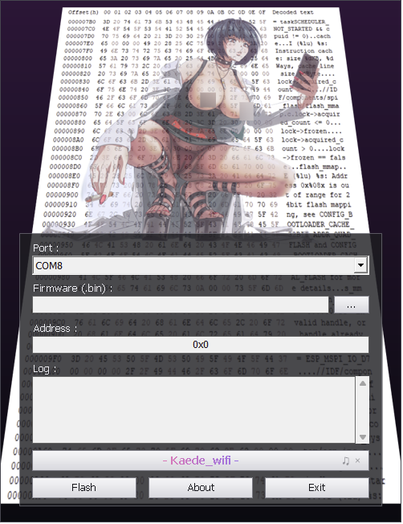

# KaedeFlasher

A Portable Windows flasher for ESP32 and ESP8266.
No Retarded Python, no esptool, no installer. One `.exe`, and it does its job.

> **Source is not public yet. It will follow here.**

## What it is

A native Win32 tool written in C++ (Win32 + GDI+). It speaks the ESP serial
bootloader protocol directly (SLIP framing, SYNC, FLASH_BEGIN / DATA / END),
so there is no esptool and no external runtime. The whole thing, background
image and music included, is baked into one ~1.8 MB executable.

## Features

- Native ESP bootloader protocol, no esptool dependency
- ESP32 and ESP8266, with chip and baud rate selection
- Pick your `.bin`, set the flash address, hit Flash
- Single `.exe`, no install and no admin rights needed

## Flash address quick reference

- Merged / complete image (bootloader + table + app) -> `0x0`
- App-only image -> `0x10000`
- ESP32-S3 / C3: bootloader sits at `0x0`, not `0x1000`

## Note on the ESP32-S3

If it hangs at "Connecting" over the native USB port, hold BOOT, tap
RESET/EN, release BOOT, then flash. The native USB-Serial/JTAG port does not
do the automatic DTR/RTS reset.

## Status

Source goes up once it is cleaned.
Until then: screenshots above, questions in the issues.

  

